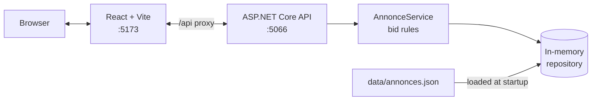
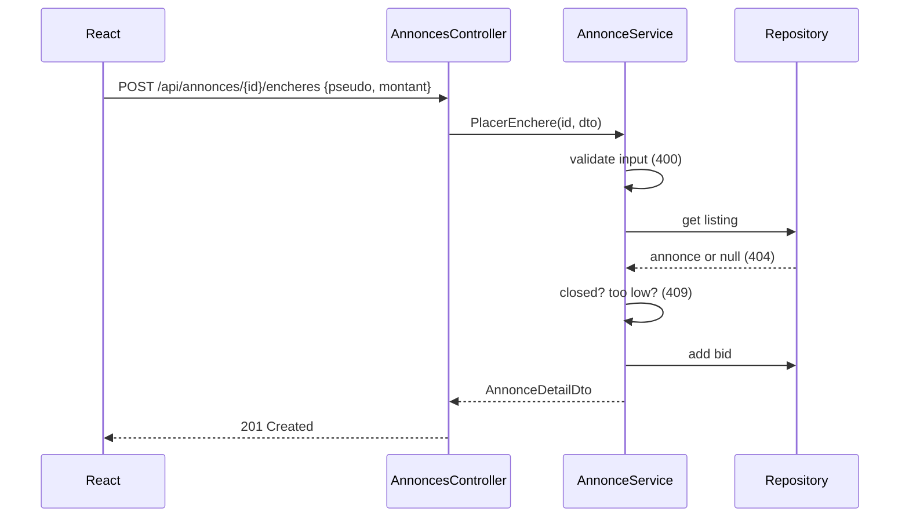

<div align="center">

# mazad

**A small online auction app: browse listings, follow the current price, place bids.**


</div>

## Features

- **Listings**: list all auctions, filter by status (`en_cours` / `terminee`) and search by title or description
- **Bidding**: place a bid with a pseudo and an amount
- **Server-side rules**: bids must beat the current price by at least the listing's step, and closed auctions refuse bids
- **Computed state**: current price, minimum bid and status are derived from bid history, never stored
- **Clear errors**: business errors map to `400` / `404` / `409` in one middleware
- **Time left**: countdown to the end date, computed client-side
- **Integration tests**: real HTTP requests against the API with `WebApplicationFactory`

## How it works



<details>
<summary>Placing a bid</summary>



</details>

| Service | Port | Role |
| --- | --- | --- |
| Frontend (Vite) | `5173` | UI, proxies `/api` to the backend |
| API (ASP.NET Core) | `5066` | REST endpoints, Swagger at `/swagger` in Development |

## Quick start

Requires **.NET 8 SDK** and **Node.js**.

```bash
git clone https://github.com/rayenamer/i-want-you-too.git && cd i-want-you-too
(cd frontend && npm install)
./start.sh
```

`start.sh` runs the backend tests, starts the API, then the frontend. Open http://localhost:5173. `Ctrl+C` stops everything.

## Usage

| Command | What it does |
| --- | --- |
| `./start.sh` | Tests + API + frontend |
| `dotnet test backend` | Run backend tests |
| `dotnet run --project backend/src/backend.Api` | Run the API only |
| `cd frontend && npm run dev` | Run the frontend only |
| `cd frontend && npm run build` | Type-check and build the frontend |
| `cd frontend && npm run lint` | Lint with oxlint |

### API

| Method | Route | Responses |
| --- | --- | --- |
| `GET` | `/api/annonces?statut=&q=` | `200`, `400` |
| `GET` | `/api/annonces/{id}` | `200`, `404` |
| `POST` | `/api/annonces/{id}/encheres` | `201`, `400`, `404`, `409` |

```bash
curl -X POST http://localhost:5066/api/annonces/a1f4c2d0-0001-4b6e-9c11-000000000001/encheres \
  -H "Content-Type: application/json" \
  -d '{"pseudo": "demo-user", "montant": 3900}'
```

## Configuration

| File | Content | Applies |
| --- | --- | --- |
| `data/annonces.json` | Seed listings and bids | Read once at API startup |
| `backend/src/backend.Api/Properties/launchSettings.json` | API ports, environment | `dotnet run` |
| `frontend/vite.config.ts` | Dev port, `/api` proxy target | `npm run dev` |

```json
{
  "id": "00000000-0000-0000-0000-000000000001",
  "titre": "Example item",
  "description": "Example description.",
  "prixDepart": 100,
  "pasEnchere": 10,
  "dateFin": "2099-12-31T18:00:00Z",
  "encheres": [{ "pseudo": "example", "montant": 110, "date": "2026-01-01T10:00:00Z" }]
}
```

Bids live in memory only: they are lost on restart, the JSON file is never rewritten.

## Project structure

```
backend/
  src/backend.Api/
    Controllers/      # HTTP only, no logic
    Services/         # bid rules, DTO mapping
    Repositories/     # IAnnonceRepository + in-memory implementation
    Domain/           # entities, DTOs, business exceptions
    Infrastructure/   # exception → HTTP status middleware
  tests/backend.Tests/  # integration tests
frontend/src/
  pages/              # listings page, detail page
  api.ts              # fetch calls to /api
data/annonces.json    # seed data
start.sh              # test + run everything
```

## Development

| You changed | Do |
| --- | --- |
| C# code | Restart the API (`dotnet run`) |
| `data/annonces.json` | Restart the API |
| React / TS code | Nothing, Vite hot-reloads |
| `vite.config.ts` | Restart `npm run dev` |
| `frontend/package.json` | `npm install` |

## Troubleshooting

| Symptom | Fix |
| --- | --- |
| Frontend shows network errors | Check the API is running on `:5066` |
| `vite: not found` | Run `npm install` in `frontend/` |
| Port `5066` or `5173` in use | Stop the other process or change the port in the config files above |
| Bids disappeared | Expected after restart, storage is in memory |
| `start.sh` stops before launching | A backend test failed, see `dotnet test backend` |

## Notes

Design choices, assumptions and open questions (concurrency, scaling): [NOTES.md](./NOTES.md).

## Author

**Rayen Ameur**, engineering student at ESIEE-IT Paris · [LinkedIn](https://www.linkedin.com/in/rayen-ameur-10000s000/)
